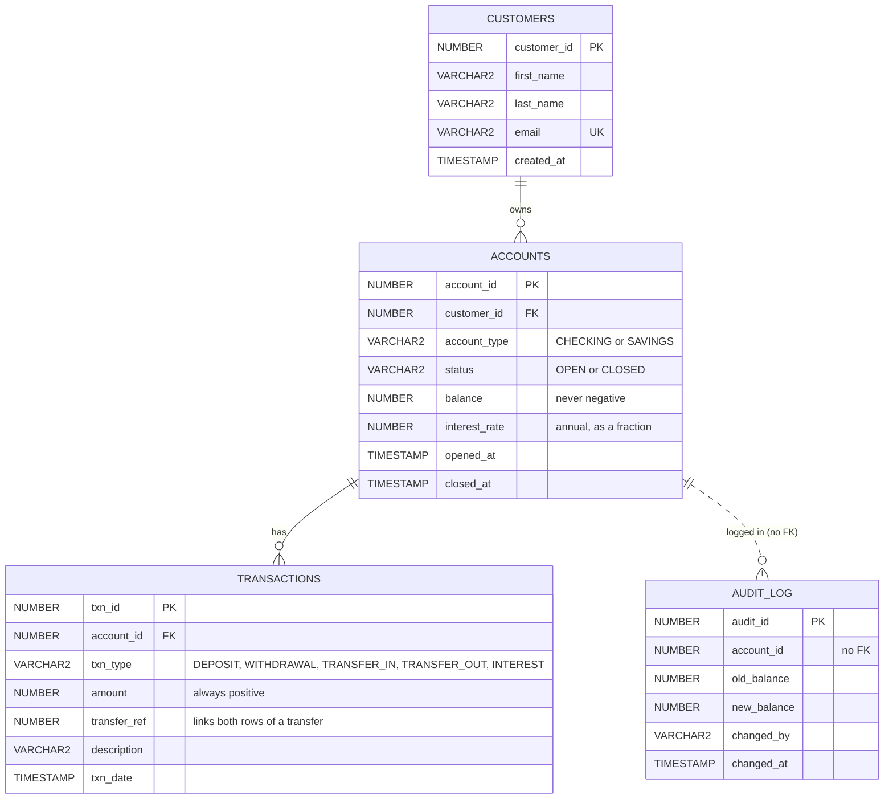

# oracle-banking-demo

A mini banking system, built to learn Oracle and PL/SQL through a practical, hands-on approach.
It runs on Oracle Database Free (23ai/26ai) in Docker.

## Features

| Feature                   | Shows                                                                    | Status |
| ------------------------- | ------------------------------------------------------------------------ | ------ |
| Docker setup              | Oracle Database Free in Docker, passwords in `.env`                      | ✅     |
| App user                  | dedicated schema user, least-privilege grants, tablespace quota          | ✅     |
| Schema with constraints   | identity columns, PK/FK, CHECK, indexes, comments                        | ✅     |
| Sample data               | set-based `INSERT … SELECT`, reproducible random data with `DBMS_RANDOM` | ✅     |
| Account package           | package spec and body, custom errors with `RAISE_APPLICATION_ERROR`      | 🚧     |
| Transfer between accounts | `SELECT … FOR UPDATE`, deadlock-free lock ordering, savepoints           | 🚧     |
| Audit log                 | row-level trigger with `:OLD` / `:NEW`                                   | 🚧     |
| Monthly interest job      | `BULK COLLECT … LIMIT`, `FORALL … SAVE EXCEPTIONS`                       | 🚧     |
| Reports                   | views with analytic functions (`SUM() OVER`, `RANK()`)                   | 🚧     |
| Unit tests                | utPLSQL                                                                  | 🚧     |

## Data Model



## Quick start

You need Docker.

```bash
cp .env.example .env    # then set your own passwords in .env
docker compose up -d
docker compose ps       # wait until the status shows "healthy"
docker compose exec oracle sqlplus /nolog @/workspace/install.sql
```

`install.sql` asks for the SYSTEM and BANK_APP passwords. Use the values from your `.env`.

## Design Choices

**Identity columns (`GENERATED ALWAYS`)**
All primary keys are identity columns. Oracle always generates the value, and it can't be inserted or changed by hand, so every ID stays unique and stable.

**Accounts are closed, never deleted**
An account is closed by setting its status to `CLOSED`; the row is never deleted. This is good practice: even after an account is closed, you can still see that it existed, together with its full history.

**AUDIT_LOG has no foreign key**
The audit log is not linked to ACCOUNTS by a foreign key, so it stays independent: even if an account were deleted, its log would remain. The log's only job is to record every balance change.
The downside: the database doesn't guarantee that the `account_id` in the log exists.
